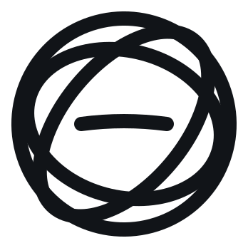
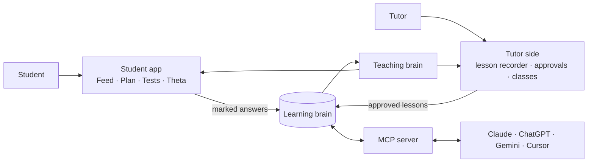
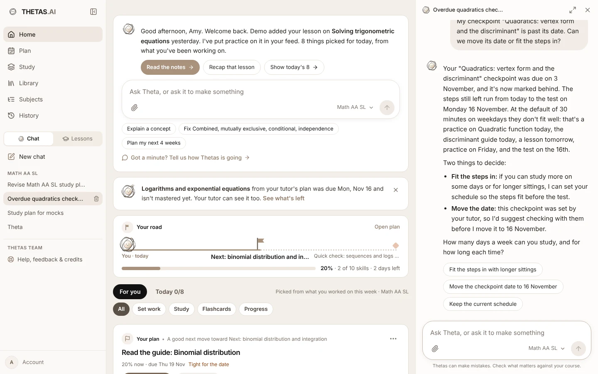
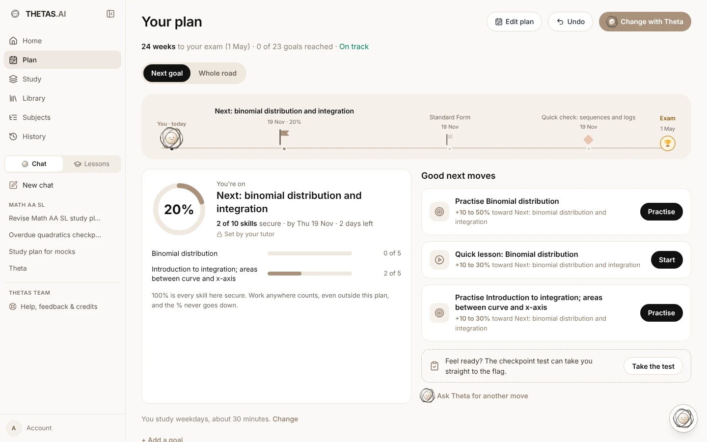
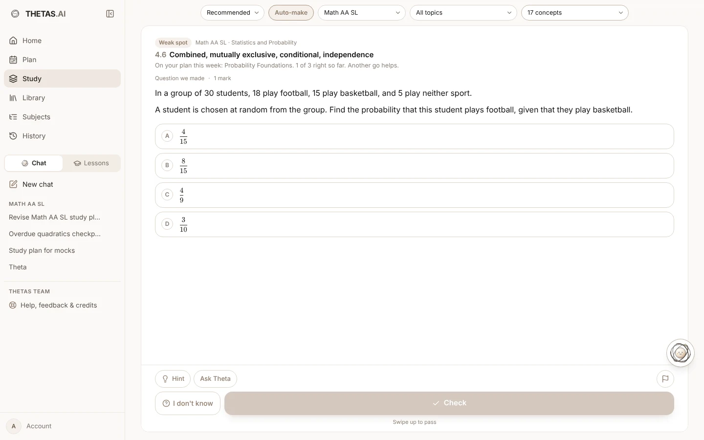
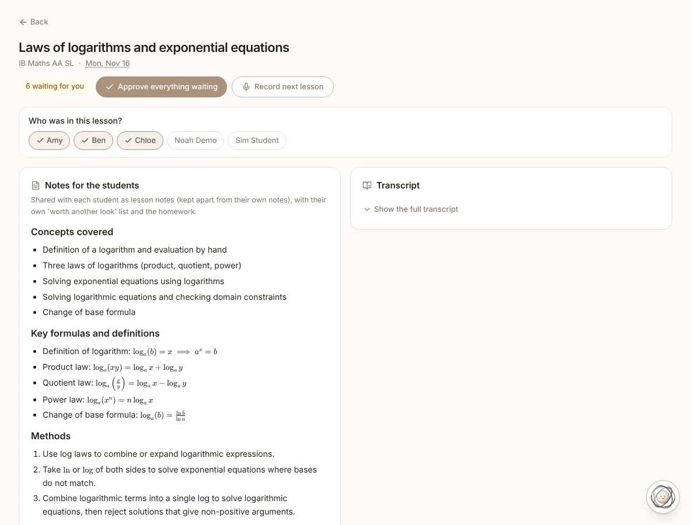
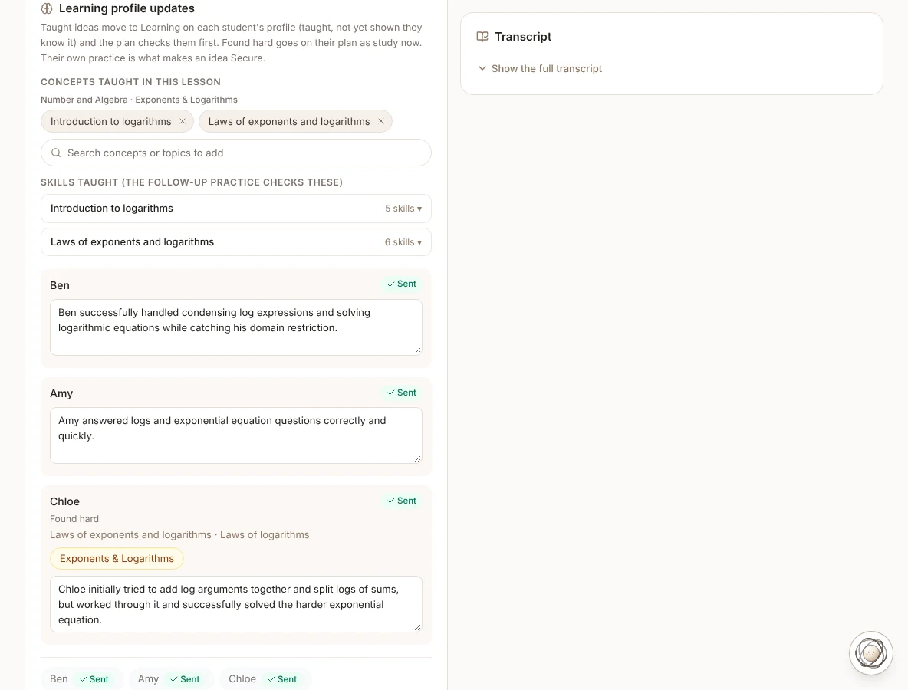
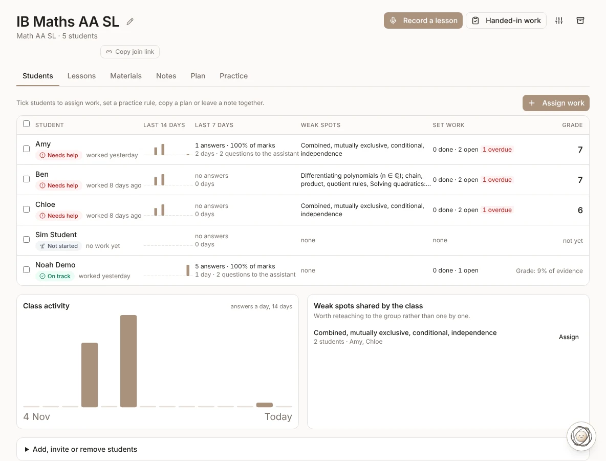
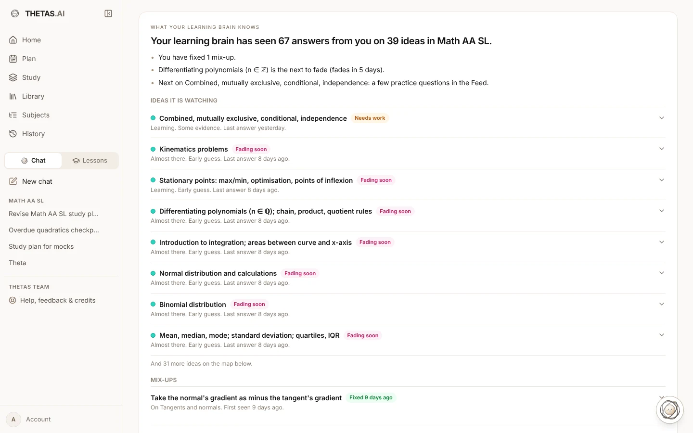
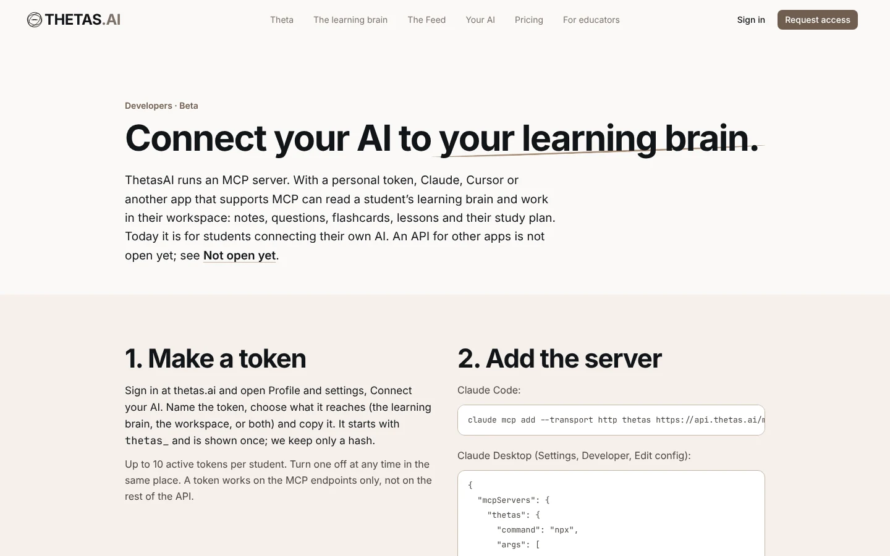

  <picture>
    <source media="(prefers-color-scheme: dark)" srcset="images/logo-dark.svg">
    
  </picture>

<h1 align="center">thetas.ai</h1>

<b>AI knows what to teach. We tell it who it's teaching.</b>

  <a href="https://thetas.ai">thetas.ai</a> (the app) ·
  <a href="https://thetas.ai/developers">thetas.ai/developers</a> (MCP docs) ·
  <a href="https://github.com/ThetasAI">github.com/ThetasAI</a> (the whole company system)

This repo is a public showcase. The application source is private, and every screenshot uses demo accounts and made-up data.

---

## The problem

AI tutors can explain almost anything, but they start every conversation without knowing what this student has actually shown they can do. A chat history is not a learning record.

thetas.ai keeps that record. A **learning brain** for each student is built from their own marked work and their tutor's lessons, and a **teaching brain** uses it to decide what they should work on next. The student app and the tutor side are the first places both are used, and any AI can read them over MCP.

## Student app

  
  

  

- **Feed**: one question at a time, picked from weak spots, set work and ideas that are about to fade. Answers are marked and go straight into the learning brain.
- **Study plan**: goals on a road to the exam date, with the next few moves to reach each one and a checkpoint test when the student is ready.
- **Tests** set by a tutor or built from the question bank.
- **Theta**: an assistant that knows the student's plan and progress, explains concepts, recaps lessons and changes the plan.
- Notes, flashcards and quick lessons for each concept, starting with IB Maths Analysis and Approaches (SL and HL).

## Tutor side

  
  

  

- **Lesson recorder**: record in the browser, and the transcript becomes lesson notes, what each student found hard and follow-up practice for each student.
- **Approvals**: nothing reaches a student until the tutor approves it, part by part and student by student.
- **Class view**: who is on track, who needs help, shared weak spots worth reteaching, and an estimated grade once there is enough evidence.

## Learning brain and MCP server

  
  

- Built only from evidence the platform checked: marked answers, explanations and checks over time. Nobody can type in that a student knows something.
- Each concept moves through New, Learning, Almost there, Secure and Mastered, and is flagged for a refresh when it starts to fade. Misconceptions are tracked too.
- Events are stored first and placed on a course map later, so the brain is not tied to one curriculum.
- MCP endpoints for the learning brain, the student's workspace and tutors. Students choose what each access token can reach. Works with Claude, ChatGPT, Gemini, Cursor and other MCP clients.

## Stack

| Part | Built with |
|---|---|
| Student app and tutor side | Next.js 15, React 19, TypeScript, Tailwind, KaTeX |
| API, learning brain, MCP server | Python, FastAPI, PostgreSQL with pgvector |
| AI | Gemini for chat, marking, transcription and embeddings; Claude for content and agent work |
| Hosting | Render |

## Status

Closed beta with IB Maths students in Hong Kong. The admin portal, lesson Studio and invoicing tools behind it are on [github.com/ThetasAI](https://github.com/ThetasAI).

---

Built by [Toby Lee](https://github.com/llhtoby38) and the Thetas team.
